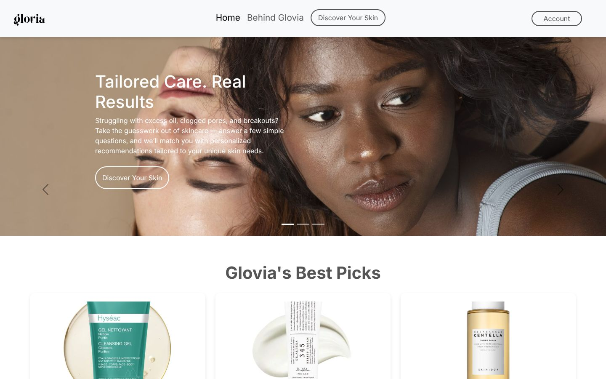
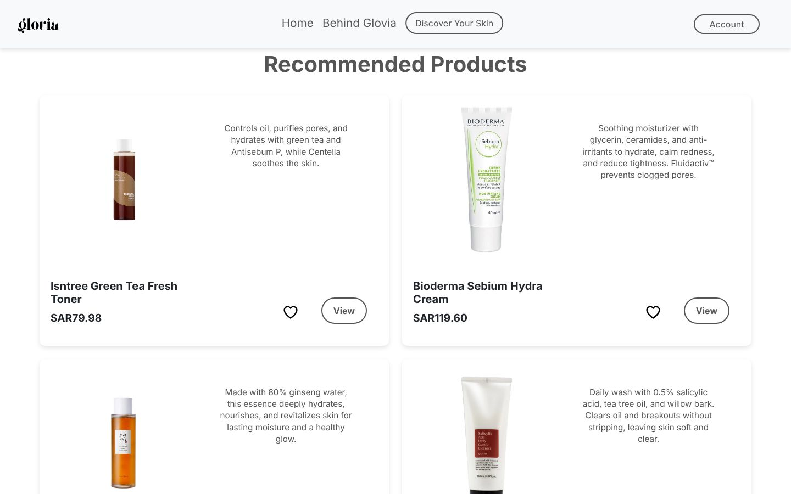
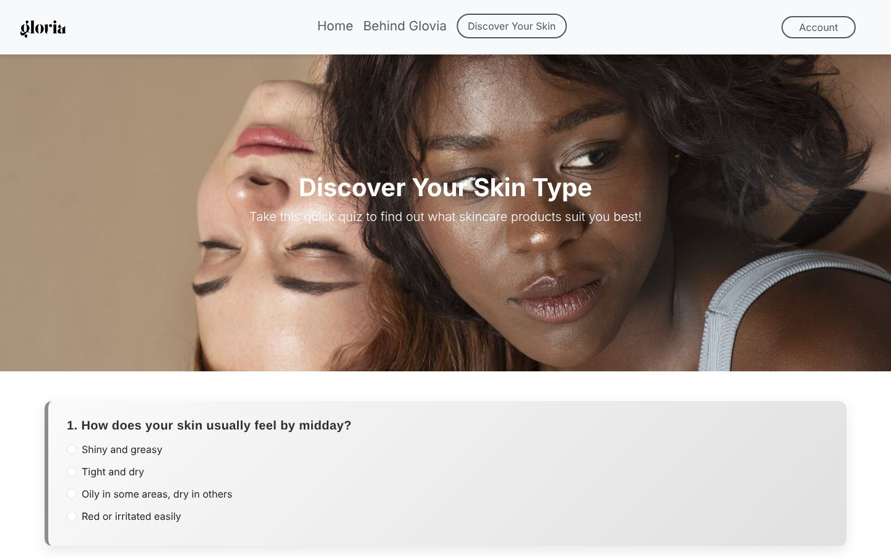
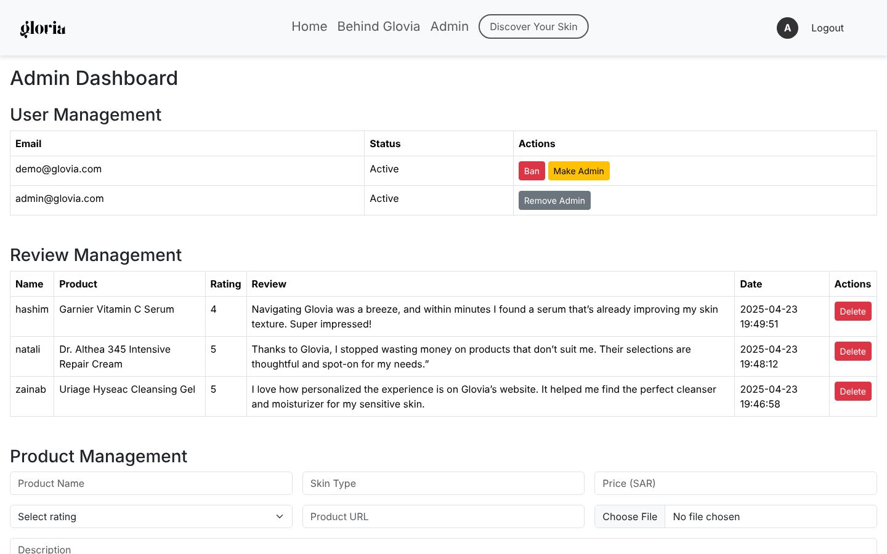

# Glovia – Personalized Skincare Recommendations

Glovia is a full-stack skincare website that helps people understand their skin and find products that suit it. Visitors take a short quiz to discover their skin type. They can then browse curated products for concerns like oily skin, dryness, redness, aging and scarring, save favorites, and leave reviews. Admins manage products, reviews and users from a dashboard.



## Features

- **Skin type quiz** – answers are scored to recommend a skin type and matching products
- **Skin concern pages** – Oily, Dryness, Combination, Redness, Aging and Scarring, each with explanations, tips and product recommendations
- **User accounts** – sign up, log in and log out, with bcrypt password hashing, login throttling and hardened sessions
- **Favorites** – like or unlike products (AJAX) and view them on a "Liked" page
- **Reviews** – logged-in users can review products; the latest reviews appear on the home page
- **Contact form** – messages are saved to the database
- **Admin dashboard** – add, edit and delete products (with image upload), delete reviews, ban or unban users, and grant or remove admin rights

| Skin concern page | Product recommendations |
|---|---|
|  |  |

| Skin quiz | Admin dashboard |
|---|---|
|  |  |

## Tech Stack

- **Frontend:** HTML, CSS, JavaScript, Bootstrap 5
- **Backend:** PHP (sessions, prepared statements with MySQLi)
- **Database:** MySQL / MariaDB
- **Local server:** XAMPP (Apache + MySQL)

## Running It Locally

1. Install [XAMPP](https://www.apachefriends.org/) and start **Apache** and **MySQL**.
2. Clone this repository into XAMPP's `htdocs` folder:
   ```bash
   cd /Applications/XAMPP/xamppfiles/htdocs   # macOS (Windows: C:\xampp\htdocs)
   git clone https://github.com/zainabthaa/glovia.git
   ```
3. Import the database. Open <http://localhost/phpmyadmin>, go to **Import**, and choose `database/database.sql`. This creates a `glovia` database with sample products.
4. Create your config file by copying `includes/config.example.php` to `includes/config.php`. The default values already match XAMPP: user `root` with no password.
5. Open <http://localhost/glovia/main.php>.

### Demo accounts

| Role  | Email              | Password   |
|-------|--------------------|------------|
| User  | demo@glovia.com    | demo1234   |
| Admin | admin@glovia.com   | admin1234  |

The admin dashboard is at `admin_login.php`.

## Security

As a cybersecurity student, I came back to review Glovia's security as I would a real application. I did manual code review against the **OWASP Top 10**, plus static analysis with **Semgrep**, then fixed what I found and wrote attack tests to prove the fixes work. The full write-up, with each issue, how it could be exploited and how it was fixed, is in **[SECURITY.md](SECURITY.md)**.

| Protection | How |
|---|---|
| SQL injection | Prepared statements for every query |
| CSRF | Per-session tokens on every form and AJAX call, checked centrally; admin actions moved from GET links to POST |
| Brute force | Login lockout after 5 failed attempts per account (20 per IP) in 15 minutes |
| Session security | `session_regenerate_id()` on login, strict mode, `HttpOnly` + `SameSite` cookies |
| User enumeration | Same message and timing for unknown email vs wrong password |
| XSS | Context-aware output encoding (`htmlspecialchars` / `json_encode`), email validation |
| Security headers | Content-Security-Policy, X-Frame-Options, nosniff, Referrer-Policy, Permissions-Policy |
| File uploads | Image-only allow-list with content check and safe file names |
| Secrets & errors | Credentials kept in an untracked config file; errors logged, never shown |

Semgrep findings went from **4 in the original code to 0**, and all **18 automated attack tests** in [`tests/security_tests.sh`](tests/security_tests.sh) pass:

```bash
BASE_URL=http://localhost/glovia ./tests/security_tests.sh
```

## Project Structure

```
glovia/
├── main.php              # Home page (carousel, best picks, reviews)
├── buildRoutine.php      # Skin type quiz + recommendations
├── oily.php, dryness.php, mixskin.php, redness.php, aging.php, scarring.php
├── liked.php, review.php, contact.php, about.php, terms.php
├── login.php, signup.php, logout.php
├── admin_login.php, admin_panel.php
├── toggle_like.php       # AJAX endpoint for likes
├── includes/
│   ├── security.php          # Security layer: headers, sessions, CSRF, login throttling
│   ├── connect.php           # Database connection
│   ├── config.example.php    # Template for database settings
│   └── check_admin.php       # Admin access guard
├── css/                  # Stylesheets
├── js/                   # Scripts
├── assets/
│   ├── images/           # Site images
│   ├── products/         # Product images
│   └── fonts/            # Custom font
├── database/
│   ├── database.sql      # Schema + sample data
│   └── migrations/       # Schema changes for existing databases
├── tests/
│   └── security_tests.sh # Automated attack tests
├── SECURITY.md           # Security review & hardening report
└── screenshots/          # Images used in this README
```

## Database

| Table              | Purpose                                   |
|--------------------|-------------------------------------------|
| `users`            | Accounts, admin and banned flags          |
| `products`         | Products with skin type, price and rating |
| `likes`            | Which user liked which product            |
| `reviews`          | User reviews                              |
| `contact_messages` | Messages from the contact form            |
| `login_attempts`   | Failed logins, used for brute-force protection |

## Skills Demonstrated

**Web development**
- Full-stack PHP application: page rendering, form handling, sessions and an admin back office
- Relational database design in MySQL (users, products, likes, reviews, contact messages, login attempts) with foreign keys
- Responsive frontend with HTML, CSS, JavaScript and Bootstrap 5
- AJAX interactions (liking products without reloading the page)
- File uploads with server-side validation
- Project organization: separate folders for includes, styles, scripts, assets and database files, with environment config kept out of version control

**Application security**
- Manual secure code review mapped to the **OWASP Top 10 (2021)**
- Finding and fixing **CSRF**, **session fixation**, **user enumeration** (including a timing side channel), **XSS sinks**, **open redirects** and **unrestricted file upload**
- Designing defenses: centrally enforced CSRF tokens, login throttling, hardened session cookies, a Content-Security-Policy and other security headers
- Secure handling of secrets and credentials: removing a hard-coded OAuth secret, untracked config files, `.gitignore` rules against leaking database dumps
- Data privacy: replacing real users' personal data with demo data before publishing

**Security testing**
- Static application security testing (**SAST**) with **Semgrep**, triaging results and documenting false positives
- Writing automated attack tests in **Bash + curl** to prove each fix works (18 tests)
- Writing a security report with risk ratings, exploitation scenarios, fixes and remaining risks ([SECURITY.md](SECURITY.md))

**Tools**
PHP · MySQL / MariaDB · JavaScript · Bootstrap · XAMPP · Git & GitHub · Semgrep · curl · phpMyAdmin
